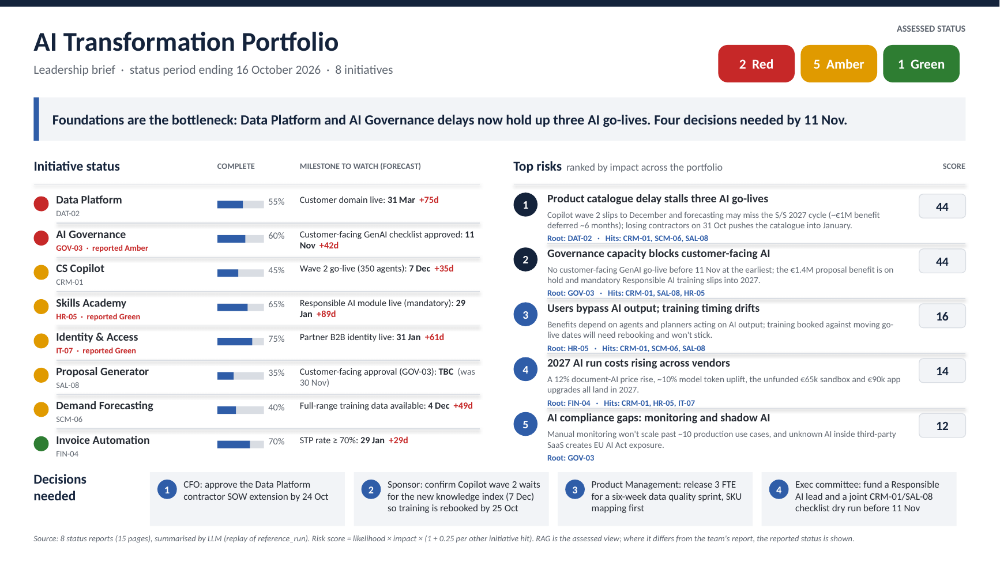
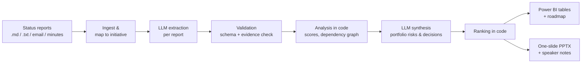
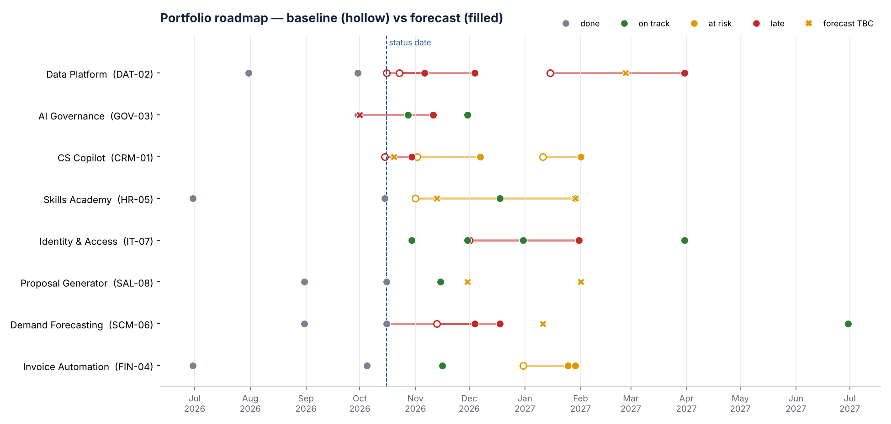

# AI Transformation Portfolio Tracker

Turns scattered status updates from change initiatives into a clear leadership view.
An LLM reads each team's update, extracts progress, milestones, risks and dependencies,
and writes the cross-initiative story. Code then scores and ranks the risks, maps who is
waiting on whom, and produces a **Power BI roadmap dataset** and a **ready-to-present,
one-slide PowerPoint brief**.

**Python · Claude API (LLM) · Power BI · python-pptx**



> Sample run: 8 mock status reports in five different formats (templates, an email, meeting
> minutes, plain-text updates) — a **15-page status pack** (`examples/status_pack.pdf`) — reduced
> to the **one slide** above, with risks ranked by portfolio impact.

---

## What it does



1. **Ingest.** Reads every report in `data/status_reports/`, whatever its layout, and maps
   it to an initiative in `data/initiatives.csv`.
2. **Extract (LLM, per report).** Claude is forced to answer through a tool whose schema is
   generated from the pydantic models in `schema.py`: reported vs *assessed* RAG, % complete,
   milestones (baseline/forecast), risks scored 1–5 for likelihood and impact, dependencies,
   asks. Invalid output is sent back to the model with the validation error for one retry.
3. **Validate.** Every risk must carry a verbatim quote from its report. The pipeline checks
   the quote is really there and flags anything it can't trace. Loose dependency mentions
   ("the Identity programme", "Data Platform team") are resolved to initiative IDs.
4. **Analyse (code).** Builds the dependency graph (networkx), counts how many initiatives
   each one is blocking, and scores every risk.
5. **Synthesise (LLM, portfolio).** Rolls initiative-level risks into portfolio risks with a
   single root cause, and drafts the headline, key messages and decisions needed.
6. **Rank (code).** Portfolio risks are ranked by score, not by the LLM's opinion.
7. **Publish.** Power BI star schema (CSV), a roadmap preview, and the PowerPoint brief.

### How risks are ranked

| | |
|---|---|
| Risk score | likelihood × impact (1–25), set by the LLM against a written rubric |
| Dependency reach | number of *other* initiatives whose delivery the risk hits |
| Portfolio score | score × (1 + 0.25 × reach) |

So a 5×5 delay in the data platform that holds up three other initiatives (score 25,
reach 3 → **44**) outranks an equally severe risk contained within one team (**25**).
The weighting is a single constant (`REACH_WEIGHT` in `analysis.py`).

### Design choices

- **The LLM reads and judges; code does the arithmetic.** Scores, ranking and the dependency
  graph are deterministic and auditable. Shuffling the LLM's list of risks does not change
  the ranking (there is a test for this).
- **Reported vs assessed RAG.** Teams tend to report Green. The model gives its own RAG from
  the evidence and explains the gap; the slide shows both (three initiatives re-rated in the
  sample, e.g. Identity & Access "GREEN-ish" → Amber).
- **Grounding check.** Every risk links back to a sentence in the source report, which is how
  a leader can ask "where does this come from?" and get an answer.
- **Replayable runs.** Each live run can be saved (`--save-run`) and replayed offline, and
  responses are cached, so the brief is reproducible and tests need no API key.

---

## Quick start

```bash
python -m venv .venv && source .venv/bin/activate   # Windows: .venv\Scripts\activate
pip install -e ".[dev]"

# Offline: replays the saved run in data/reference_run (no API key needed)
portfolio-tracker run

# Live: Claude reads the reports and writes the synthesis
export ANTHROPIC_API_KEY=sk-ant-...                  # see .env.example
portfolio-tracker run --provider claude --save-run data/my_run -v
```

Output in `output/`:

| File | Purpose |
|---|---|
| `portfolio_brief_<date>.pptx` | One-slide leadership brief; speaker notes hold key messages, full risk register and any data-quality warnings |
| `powerbi/*.csv` | Star schema for the Power BI report (see [`powerbi/README.md`](powerbi/README.md)) |
| `roadmap_preview.png` | Static baseline-vs-forecast roadmap |
| `status_pack.pdf` | The input reports as one A4 pack, for measuring what was condensed |

Use your own reports: drop files named `<ID>_anything.md|txt` into a folder, list the
initiatives in a CSV like `data/initiatives.csv`, and run
`portfolio-tracker run --provider claude --reports <folder> --registry <csv>`.
The model defaults to `claude-sonnet-5-5`; override with `--model` or `PORTFOLIO_TRACKER_MODEL`.

## Power BI

`powerbi/` contains the Power Query load script, DAX measures, a theme and a Vega-Lite
roadmap for the Deneb visual. [`powerbi/README.md`](powerbi/README.md) walks through
building the four-page report (Overview, Roadmap, Risks heat map, Dependencies).



## Repository layout

```
data/
  status_reports/        8 mock status updates (fictional organisation)
  initiatives.csv        initiative master data + aliases for name resolution
  reference_run/         saved LLM outputs in replay format (see note below)
src/portfolio_tracker/
  schema.py              pydantic contracts for LLM output
  llm.py                 Claude provider (forced tool use, retry, cache) + replay provider
  prompts.py             extraction and synthesis prompts (versioned)
  analysis.py            grounding check, dependency graph, scoring, ranking
  powerbi.py             star-schema export
  brief.py               python-pptx one-slide brief
  roadmap.py             roadmap PNG
  statuspack.py          renders the input reports to a PDF pack
  pipeline.py, cli.py
powerbi/                 M, DAX, theme, Deneb spec, build guide
examples/                sample outputs from the reference run
tests/                   pytest suite (offline)
```

**About `data/reference_run`.** These are the extraction and synthesis outputs used to
produce the examples and to run the tests offline. They were written and checked by hand
against the schema (every risk passes the evidence check), not captured from a live API
call. Run with `--provider claude --save-run data/reference_run` to replace them with a
live model run.

## Tests

```bash
pytest -q
```

Covers name resolution, the grounding check (including a fabricated quote being caught),
dependency reach, scoring, ranking stability, the LLM retry-on-invalid-output path (with a
fake client), and an end-to-end run that builds the slide and all Power BI tables.

---

All organisations, people and figures in the sample data are fictional.
