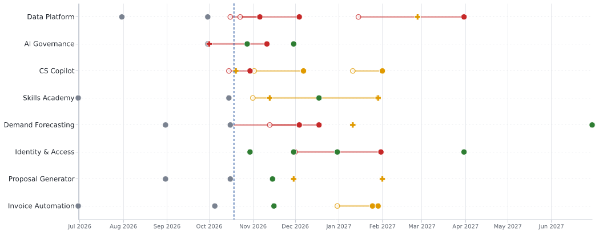

# Power BI roadmap and portfolio report

The tracker exports a small star schema (`output/powerbi/*.csv`). This folder has
everything needed to build the report on top of it in Power BI Desktop:

| File | What it is |
|---|---|
| `load_tables.pq` | Power Query (M) for each table, with column types |
| `measures.dax` | Portfolio measures (RAG counts, slips, risk exposure, dependency reach, colour helpers) |
| `theme.json` | Report theme matching the PowerPoint brief |
| `roadmap.deneb.json` | Vega-Lite roadmap spec for the [Deneb](https://deneb-viz.github.io/) certified visual |

A `.pbix` is not committed: it is a binary that can't be diffed or reviewed, and it
would hard-code a local file path. The steps below rebuild it in about 15 minutes.

## 1. Load the data

1. Run the pipeline so `output/powerbi/` exists (or point at `examples/powerbi_export/`).
2. Power BI Desktop → **Transform data** → **Manage parameters** → new text parameter
   `OutputFolder` = full path to that folder, with a trailing `\`.
3. For each block in `load_tables.pq`: **New source → Blank query → Advanced editor**,
   paste, and name the query as in the comment (`dim_initiative`, `fact_milestone`, …).
4. **View → Themes → Browse for themes** → `theme.json`.

## 2. Model

```
                       ┌──────────────────┐
     fact_milestone ──*│                  │1── bridge_portfolio_risk ──*  portfolio_risk
     fact_risk ───────*│  dim_initiative  │                (rank)       1 (rank)
     fact_dependency ─*│  (initiative_id) │
     (from_initiative_id, active)         │
     fact_dependency ─*┄┄┄┄┄┄┄┄┄┄┄┄┄┄┄┄┄┄┄│  (to_initiative_id, INACTIVE)
                       └──────────────────┘
```

- All relationships single direction, dimension → fact.
- `fact_dependency[to_initiative_id]` → `dim_initiative[initiative_id]` is **inactive**;
  the measure *Initiatives Waiting On This* activates it with `USERELATIONSHIP`.
- `portfolio_risk[rank]` 1 → * `bridge_portfolio_risk[rank]`, and
  `dim_initiative[initiative_id]` 1 → * `bridge_portfolio_risk[initiative_id]`.
  Set the bridge-to-portfolio_risk relationship to **both** directions so slicing by
  initiative filters the portfolio risk list.
- Sort `dim_initiative[short_name]` by `rag_sort` (Column tools → Sort by column) so
  red initiatives always appear first.
- Paste the measures from `measures.dax` into a `_Measures` table.

## 3. Pages

**Overview**
- Cards: `Red Initiatives`, `Amber Initiatives`, `Green Initiatives`, `Slipped Milestones`,
  `Blocking Dependencies`, `Re-rated Initiatives`.
- Table: `short_name`, `assessed_rag`, `reported_rag`, `percent_complete` (data bar),
  `headline`, `Initiatives Waiting On This`. Conditional format the RAG column's
  background with *Field value* → `RAG Colour`.
- Table: `portfolio_risk` — `rank`, `title`, `affected_initiatives`, `portfolio_score`,
  `recommended_action`.

**Roadmap**
- Get the **Deneb** visual from AppSource (certified). Add fields
  `dim_initiative[short_name]`, `dim_initiative[rag_sort]`, and from `fact_milestone`:
  `milestone`, `baseline_date`, `forecast_date`, `plot_date`, `slip_days`, `status`
  (set each to *Don't summarize*).
- Edit specification → Vega-Lite → paste `roadmap.deneb.json`.
- Hollow marker = baseline, filled = forecast, line = slip, cross = forecast TBC,
  dashed line = today. Preview with the sample data:

  

- No custom visuals allowed in your tenant? Use a table of `fact_milestone` with
  `slip_days` as data bars and `Milestone Colour` as the status background.

**Risks**
- Matrix: rows `impact` (descending), columns `likelihood`, values `Risk Count`;
  background colour → *Field value* `Risk Heat Colour`. This is the classic 5×5 heat map.
- Table: `fact_risk` — `risk_id`, `title`, `category`, `score`, `portfolio_score`,
  `mitigation`, `evidence`, `grounded`. Filter `grounded = FALSE` on a separate card to
  surface any LLM statement that could not be traced to its source report.

**Dependencies**
- Matrix: rows `fact_dependency[from_initiative_id]`, columns `to_initiative_id`,
  values `First status`. Shows at a glance who is waiting on whom.

## 4. Refresh

Re-run `portfolio-tracker run` with the new week's reports, then **Refresh** in Power BI.
The CSV names and columns are stable between runs.
